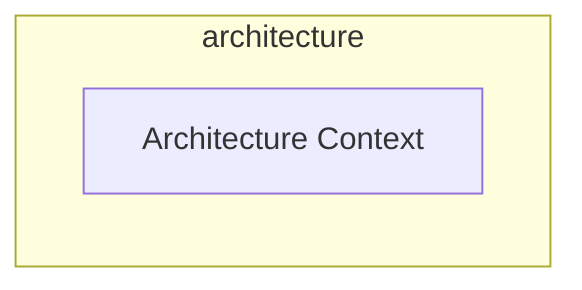
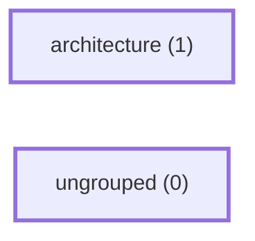
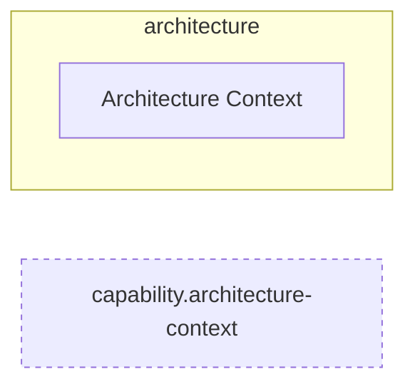

<!-- Generated by ArchContext (archctx history). Do not edit by hand. -->

Architecture history contains 24 milestones. Run `archctx history` for the full list.

## 2026-11-08 · cbc5761aac96

Merge pull request #501 from Ancienttwo/chore/498-adr-0053-removal

Added 0 · Removed 2 · Renamed 0 · Edges +0 −0




## 2026-09-28 · 815cbcbcd8e1

Merge pull request #241 from Ancienttwo/claude/local-runtime-scc-pr2

Added 1 · Removed 0 · Renamed 0 · Edges +0 −0


## 2026-09-27 · ff712bcb653a

Merge pull request #234 from Ancienttwo/claude/recommendations-service-164

Added 1 · Removed 0 · Renamed 0 · Edges +0 −0


## 2026-09-27 · d6cc90ce4a5f

Merge pull request #233 from Ancienttwo/claude/book-service-164

Added 1 · Removed 0 · Renamed 0 · Edges +0 −0


## 2026-09-27 · 9d7f14286cb1

Merge pull request #229 from Ancienttwo/codex/local-runtime-scc-pr1

Added 1 · Removed 0 · Renamed 0 · Edges +0 −0


## 2026-09-27 · 331c526a560b

Merge pull request #223 from Ancienttwo/codex/remaining-audit-issues

Added 6 · Removed 1 · Renamed 0 · Edges +0 −0





## 2026-09-25 · e3d807759e91

Merge pull request #219 from Ancienttwo/codex/developer-review-session-164

Added 0 · Removed 0 · Renamed 1 · Edges +0 −0


## 2026-09-25 · ee8de7cfb0dd

Merge pull request #218 from Ancienttwo/codex/explorer-server-164

Added 1 · Removed 0 · Renamed 0 · Edges +0 −0


## 2026-09-25 · 727eecfb2dec

Merge pull request #217 from Ancienttwo/codex/process-liveness-164

Added 1 · Removed 0 · Renamed 0 · Edges +0 −0


## 2026-09-25 · 845eacc1cee0

Merge pull request #216 from Ancienttwo/codex/ledger-admin-164

Added 1 · Removed 0 · Renamed 0 · Edges +0 −0


## 2026-09-25 · a62b9a7a818d

Merge pull request #214 from Ancienttwo/codex/audit-service-164

Added 1 · Removed 0 · Renamed 0 · Edges +0 −0

```mermaid
flowchart LR
  d0["ungrouped (1)"]
  class d0 changed
  classDef changed stroke-width:3px
```

```mermaid
flowchart LR
  n0["Architecture Context"]
```

## 2026-09-25 · 47c65c8c2f2c

Merge pull request #213 from Ancienttwo/codex/projection-apply-164

Added 1 · Removed 0 · Renamed 0 · Edges +0 −0

```mermaid
flowchart LR
  d0["ungrouped (1)"]
  class d0 changed
  classDef changed stroke-width:3px
```

```mermaid
flowchart LR
  n0["Architecture Context"]
```

## 2026-09-25 · 88d7f2ac8b66

Merge pull request #212 from Ancienttwo/codex/projection-service-165

Added 1 · Removed 0 · Renamed 0 · Edges +0 −0

```mermaid
flowchart LR
  d0["ungrouped (1)"]
  class d0 changed
  classDef changed stroke-width:3px
```

```mermaid
flowchart LR
  n0["Architecture Context"]
```

## 2026-09-25 · 291e1d0d0b3f

Merge pull request #211 from Ancienttwo/codex/developer-review-runs-164

Added 1 · Removed 0 · Renamed 0 · Edges +0 −0

```mermaid
flowchart LR
  d0["ungrouped (1)"]
  class d0 changed
  classDef changed stroke-width:3px
```

```mermaid
flowchart LR
  n0["Architecture Context"]
```

## 2026-09-25 · c2a8d8ffc8c6

Merge pull request #209 from Ancienttwo/codex/review-state-165

Added 1 · Removed 0 · Renamed 0 · Edges +0 −0

```mermaid
flowchart LR
  d0["ungrouped (1)"]
  class d0 changed
  classDef changed stroke-width:3px
```

```mermaid
flowchart LR
  n0["Architecture Context"]
```

## 2026-09-25 · 39e9dff81bb3

Merge pull request #208 from Ancienttwo/codex/rpc-client-entry-164

Added 1 · Removed 0 · Renamed 0 · Edges +0 −0

```mermaid
flowchart LR
  d0["ungrouped (1)"]
  class d0 changed
  classDef changed stroke-width:3px
```

```mermaid
flowchart LR
  n0["Architecture Context"]
```

## 2026-09-25 · 901e4b8b8ec6

Merge pull request #207 from Ancienttwo/codex/rpc-method-table-164

Added 0 · Removed 0 · Renamed 1 · Edges +0 −0

```mermaid
flowchart LR
  d0["ungrouped (1)"]
  class d0 changed
  classDef changed stroke-width:3px
```

```mermaid
flowchart LR
  n0["Architecture Context"]
```

## 2026-09-25 · 176e0a491b84

Merge pull request #206 from Ancienttwo/codex/rpc-server-164

Added 1 · Removed 0 · Renamed 0 · Edges +0 −0

```mermaid
flowchart LR
  d0["ungrouped (1)"]
  class d0 changed
  classDef changed stroke-width:3px
```

```mermaid
flowchart LR
  n0["Architecture Context"]
```

## 2026-09-25 · 27a0379c705c

Merge pull request #205 from Ancienttwo/codex/rpc-split-164

Added 1 · Removed 0 · Renamed 0 · Edges +0 −0

```mermaid
flowchart LR
  d0["ungrouped (1)"]
  class d0 changed
  classDef changed stroke-width:3px
```

```mermaid
flowchart LR
  n0["Architecture Context"]
```

## 2026-09-25 · 05d4d2b81533

Merge pull request #187 from Ancienttwo/claude/self-arch-ownership-163

Added 7 · Removed 0 · Renamed 0 · Edges +0 −0

```mermaid
flowchart LR
  d0["ungrouped (1)"]
  class d0 changed
  classDef changed stroke-width:3px
```

```mermaid
flowchart LR
  n0["Architecture Context"]
```

